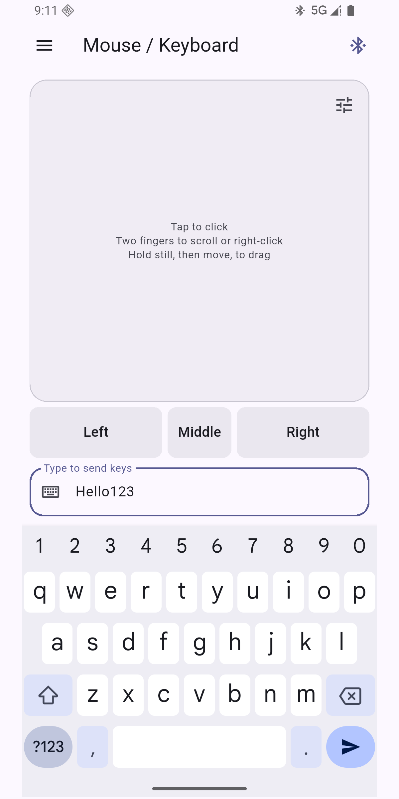
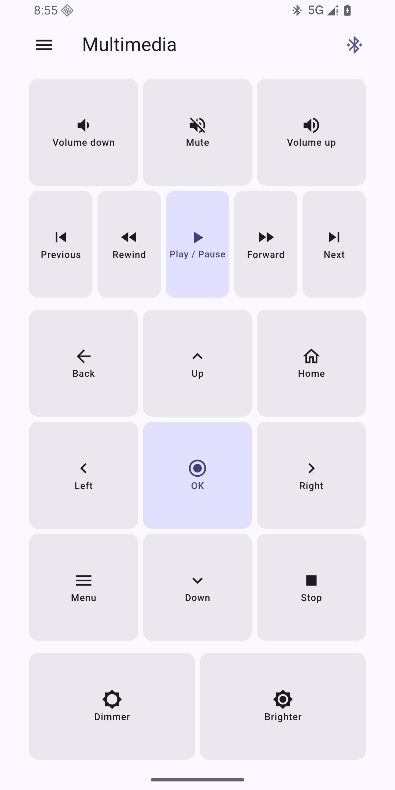
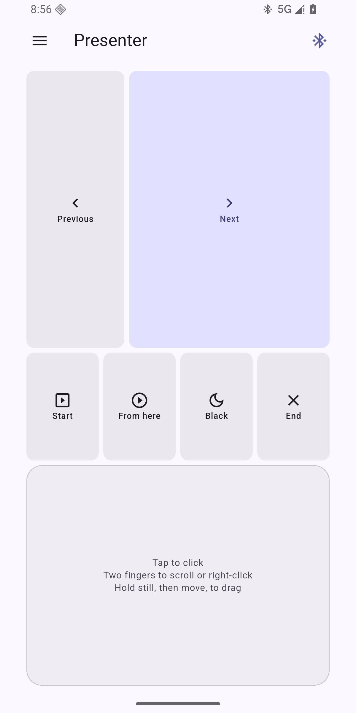
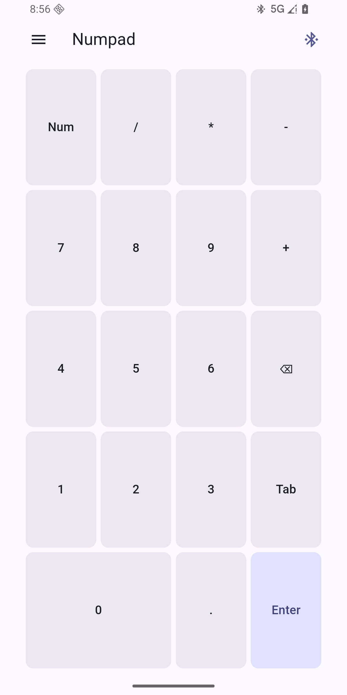

# HidPad

Use an Android phone as a Bluetooth keyboard and mouse. The phone connects to the
computer directly, as a standard Bluetooth input device. The computer needs no
extra software.

<p>
  
  
  
  
</p>

## Download

- **APK:** the newest build is on the [releases page](https://github.com/buhuipao/hidpad/releases).
  Open the `.apk` file on the phone and allow the install.

HidPad is free and open source under the [MIT license](LICENSE). It has no ads, no account, and
no analytics of its own; see the [privacy policy](PRIVACY.md), which the app menu links to as well.

## Screens

| Screen | What it does |
|---|---|
| Mouse / Keyboard | Touchpad (move, tap to click, two fingers to scroll or right-click, three-finger tap for middle click, hold still then move to drag), three mouse buttons, and a text box that types with the phone keyboard |
| Multimedia | Volume, play / pause, previous / next, rewind / forward, stop, arrows with OK / Back / Home / Menu, screen brightness |
| PC keyboard | US keyboard in landscape: letters, digits, symbols, Space, Enter, Backspace, F1-F12, Esc, Tab, Caps, PrtSc, Del, Home, End, PgUp, PgDn, arrows. Tap Ctrl / Shift / Alt / AltGr / Win once to hold it for the next key, twice to lock it, a third time to release it |
| Numpad | Numeric keypad |
| Presenter | Next / previous slide, start, start from current slide, black screen, end, and a pointer pad |
| Code scanner | Scans QR codes and barcodes and types their text, with an optional Enter. A code is typed again only after it was out of view for two seconds |
| Bluetooth devices | Connection status, pairing steps, list of paired devices |

## Requirements

- Android 9 or newer. The phone must allow the Bluetooth HID device role; a few
  phone makers turn it off.
- A computer, tablet, or TV that accepts a standard Bluetooth keyboard and mouse.
  Tested with Windows and Android.

## Pairing

1. Open HidPad. On Android 12 and newer, allow the "Nearby devices" permission.
2. Open **Bluetooth devices** and tap **Make this phone visible**.
3. On the computer, open Bluetooth settings, add a device, and choose the phone.
4. Confirm the pairing code on both sides.

If the phone and the computer were paired before (or paired through another
Bluetooth keyboard app), remove the pairing on both sides first. The computer
stores the keyboard description at pairing time and keeps using the old one.

Only one app can hold the Bluetooth keyboard role. Close other Bluetooth keyboard
apps before opening HidPad.

## Limits

- Text is typed with a US key map. Set the computer's keyboard layout to US, or
  some symbols come out different. Characters with no US key are skipped.
- The connection lives while HidPad is on screen. Leaving the app or locking
  the phone disconnects. Coming back reconnects to the last device, unless you
  tapped **Disconnect**.
- The screen stays on while a device is connected.
- Back closes the menu or the pointer settings sheet, never the app, so a swipe
  from the screen edge on the touchpad cannot drop the connection. Leave with
  Home.
- Every screen is portrait, except the PC keyboard, which is landscape.
- The media report holds one key at a time.
- Scrolling moves in whole wheel notches.
- Android only. iOS does not let an app publish the Bluetooth HID service
  (CoreBluetooth rejects UUID `0x1812`), so an iPhone cannot act as a standalone
  Bluetooth keyboard through public APIs.

## Build

Needs Flutter 3.44.4 or newer (Dart 3.12.2+), JDK 17, and the Android SDK.

```sh
flutter pub get
flutter analyze
flutter build apk --release
# build/app/outputs/flutter-apk/app-release.apk
```

### Signing

A release build is signed with the keystore named in `android/key.properties`, a file that is
kept out of Git:

```properties
storeFile=/path/to/keystore.jks
storePassword=...
keyAlias=...
keyPassword=...
```

The file is read as Java properties, so a password must not contain a backslash. With no
`key.properties`, the build is signed with the debug key. Such a build is fine for a
local test, but it cannot update an installed release.

### Automatic builds

- Every push to `main` and every pull request runs `flutter analyze` and a build
  (`.github/workflows/ci.yml`).
- Pushing a tag such as `v1.2.3` builds the signed APK and app bundle and publishes them as a
  GitHub release (`.github/workflows/release.yml`). The tag must match `version` in
  `pubspec.yaml`. The workflow reads three repository secrets: `KEYSTORE_BASE64` (the keystore
  file, base64-encoded), `KEYSTORE_PASSWORD` (used for the store and the key), and `KEY_ALIAS`.

## Code map

| Path | Purpose |
|---|---|
| `android/app/src/main/kotlin/com/buhuipao/hidpad/MainActivity.kt` | Registers the phone as a HID device (`BluetoothHidDevice`), connects, sends reports |
| `android/app/src/main/kotlin/com/buhuipao/hidpad/HidDescriptor.kt` | HID report descriptor: keyboard (id 1), mouse (id 2), media keys (id 3) |
| `lib/main.dart` | App frame: theme, top bar, navigation drawer |
| `lib/hid.dart` | Dart side of the `hidpad` channel: connection state, keyboard / mouse / media reports |
| `lib/keys.dart` | HID usage codes and the US character map |
| `lib/widgets.dart` | Shared widgets: key button, touchpad, typing box, connection banner |
| `lib/pages/` | One file per screen |
| `tool/icon.swift` | Draws the launcher icons and the store graphics (macOS: `swift tool/icon.swift`) |
| `fastlane/metadata/android/` | Google Play listing: texts, icon, banner, screenshots |
| `.github/workflows/` | Automatic builds and releases |
